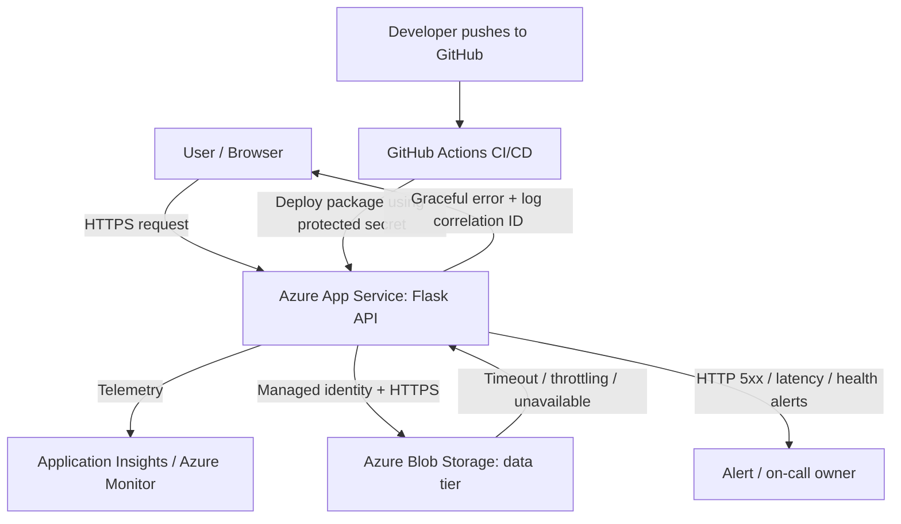

# Service Blueprint

## Purpose
A small two-tier web service with a Python web/API tier and a persistent data tier. The design is intentionally simple so request handling, operations, and failure behavior can be discussed before deployment.

## Architecture diagram

## Request path
1. User sends an HTTPS request.
2. Azure App Service receives the request and runs the Flask application.
3. The application validates input and performs the required operation.
4. For persistent data, the application calls Blob Storage over HTTPS using managed identity.
5. The application returns a response and sends request telemetry to Application Insights.

## Dependency path
- Primary dependency: Azure Blob Storage (persistent data).
- Observability dependency: Application Insights / Azure Monitor.
- Deployment dependency: GitHub Actions and Azure deployment credentials.
- If a dependency is slow or unavailable, set a timeout, log the failure, return a safe error, and alert if the SLO is at risk.

## Deployment path
1. Developer commits and pushes to the default branch.
2. GitHub Actions runs the deployment workflow.
3. Workflow authenticates using a repository secret (never a literal credential).
4. Package is deployed to Azure App Service.
5. Health endpoint and logs are checked after deployment.
6. If the release fails, redeploy the last known-good version and record the incident.

## Data path
- Planned durable data tier: Azure Blob Storage.
- Access should use a managed identity and a narrowly scoped Storage Blob Data role.
- Enable soft delete/versioning where appropriate; define retention based on business needs.
- The demo app currently uses in-memory state only; persistent storage integration is a follow-up task.

## Failure paths and responses

| Failure | User impact | Detection | Response |
|---|---|---|---|
| App Service process crashes | Requests fail | Health check / 5xx alert | Restart or redeploy; inspect logs |
| Slow storage response | Increased latency | Dependency duration / timeout metric | Use bounded timeout, retry only safe operations, alert on sustained errors |
| Storage unavailable | Data operation fails | Dependency failures | Return controlled 503; preserve logs; retry after recovery |
| Bad deployment | New version fails | Post-deploy health check | Roll back to last known-good release |
| Latency/5xx SLO burn | Degraded service | SLO alert | Page on-call owner and reduce change risk |
| Budget overrun | Unexpected bill | Azure Cost Management budget alert | Review usage and scale down nonessential resources |

## Operational ownership
- Owner: project maintainer
- Initial support hours: business hours for a learning project
- Severity 1: service unavailable for users or suspected data/security incident
- Severity 2: SLO breach or repeated failures with workaround
- Severity 3: isolated noncritical issue
